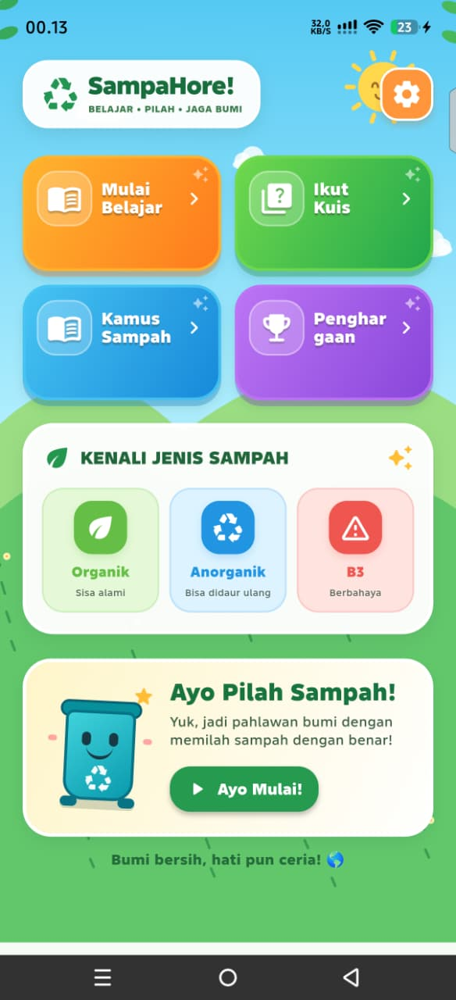
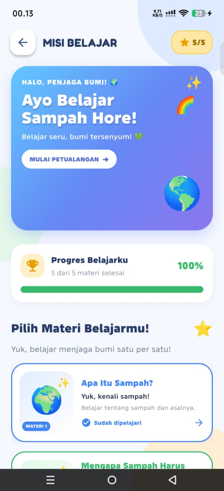
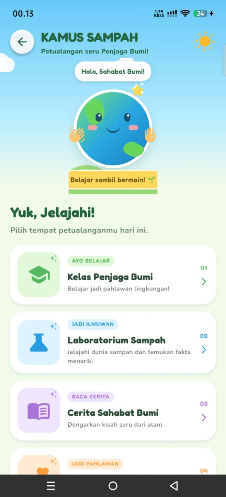

# ♻️ SampahHore

### Aplikasi Edukasi Pemilahan Sampah Berbasis Android

SampahHore merupakan aplikasi pembelajaran interaktif berbasis Android yang dirancang untuk membantu anak-anak mengenal berbagai jenis sampah serta memahami pentingnya menjaga kebersihan lingkungan melalui materi edukasi dan kuis interaktif.

Aplikasi ini mengenalkan tiga kategori utama sampah, yaitu Organik, Anorganik, dan B3 dengan tampilan visual yang menarik dan mudah dipahami.

---

## 📱 Preview Aplikasi

  
  
  
  

  Menu Utama · Mulai Belajar · Kuis · Kamus Sampah

---

## ✨ Fitur Utama

- **Menu Utama:** Navigasi menuju berbagai fitur pembelajaran.
- **Mulai Belajar:** Mengenal kategori sampah Organik, Anorganik, dan B3.
- **Kuis Interaktif:** Menguji pemahaman pengguna melalui soal-soal edukatif.
- **Kamus Sampah:** Menyediakan informasi dan pengenalan berbagai jenis sampah.
- **Sistem Penilaian:** Menampilkan skor dan perolehan bintang berdasarkan hasil kuis.
- **Audio Aplikasi:** Menambahkan pengalaman belajar yang lebih interaktif.
- **Tampilan Ramah Anak:** Menggunakan desain visual penuh warna dan mudah dipahami.

## 🗑️ Kategori Pembelajaran

| Kategori | Deskripsi |
|---|---|
| 🌱 Organik | Sampah yang berasal dari bahan alami dan dapat terurai secara biologis. |
| ♻️ Anorganik | Sampah seperti plastik, kaca, dan logam yang membutuhkan penanganan khusus untuk didaur ulang. |
| ☣️ B3 | Sampah yang mengandung bahan berbahaya dan beracun sehingga membutuhkan penanganan khusus. |

## 🛠️ Teknologi yang Digunakan

- **Flutter** – Framework pengembangan aplikasi.
- **Dart** – Bahasa pemrograman.
- **Android SDK** – Platform pengembangan Android.

## 📥 Download Aplikasi

Dapatkan versi terbaru aplikasi SampahHore melalui halaman GitHub Releases.

**[⬇️ Download SampahHore APK](https://github.com/mubinsy-gt/SampahHore-APK/releases/latest)**

## 📲 Cara Instalasi

1. Buka halaman GitHub Releases.
2. Unduh file APK versi terbaru.
3. Buka file APK melalui perangkat Android.
4. Izinkan instalasi dari sumber yang tidak dikenal apabila diminta.
5. Selesaikan proses instalasi.
6. Buka aplikasi SampahHore dan mulai belajar!

## 🎯 Tujuan Pengembangan

SampahHore dikembangkan sebagai media pembelajaran digital yang bertujuan untuk:

- Memperkenalkan jenis-jenis sampah kepada anak-anak.
- Meningkatkan pemahaman mengenai pemilahan sampah.
- Membangun kebiasaan menjaga kebersihan lingkungan sejak dini.
- Menghadirkan proses pembelajaran yang lebih menarik melalui media interaktif.

## 👨‍💻 Pengembang

**Muhammad Bintang Syakhila**

Project pengembangan aplikasi edukasi berbasis Android menggunakan Flutter.

---

  <b>♻️ SampahHore</b> 
  Belajar Memilah Sampah, Mulai dari Sekarang! 🌱

